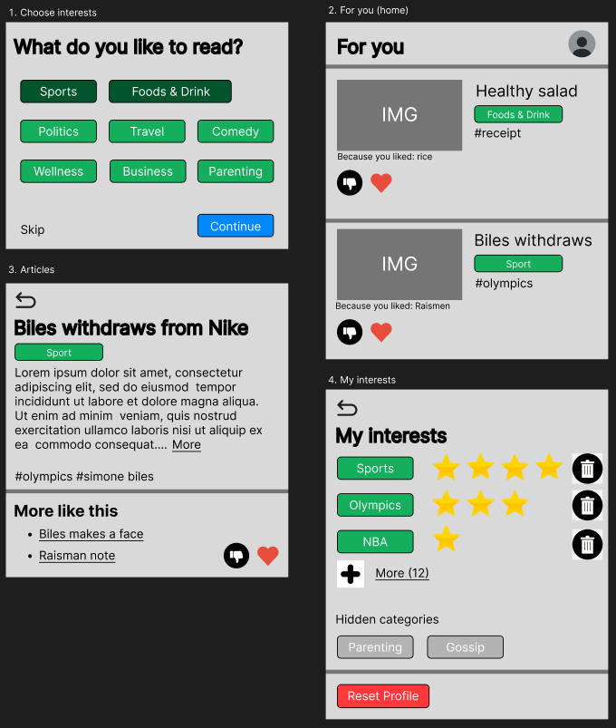

# Explanation

## Task 1: TF-IDF on "Food & Drink"

`evaluate.py` builds TF-IDF vectors from the `description` field of all 5,285 articles (lowercase, English stopwords removed, Porter stemmer, like in the course examples) and puts them into one `MatrixSimilarity` index. For each of the 122 Food & Drink articles we take the 10 most similar articles of the whole corpus and count how many of them are Food & Drink too. In the CSV the section is called "Food & Drink", not "Food and Drink".

The article itself is not counted in its own top 10. It is always its own best match, so keeping it would give every article one free correct neighbour. The top 10 are the 10 most similar other articles. We do the same for every model and section below.

Result: ratio_quality = 0.599, so 731 of the 1,220 neighbours are Food & Drink. Creating the model took 32.5 s and the top-10 loop 17.6 s. The model time starts right after reading the CSV (about 0.2 s) and stops after `MatrixSimilarity`, so it includes the preprocessing, the dictionary, the TF-IDF model and the index. All numbers are in `results/ratio_quality_results.csv`.

## Task 2: LDA compared with TF-IDF

We ran the same loop with LDA vectors (30 topics, 2 passes, random_state 30). "Model build" is the time up to `MatrixSimilarity`, "top-10 loop" is the pseudocode loop.

| model | section | ratio_quality | model build | top-10 loop |
| --- | --- | --- | --- | --- |
| TF-IDF | Food & Drink | 0.599 | 32.5 s | 17.6 s |
| LDA | Food & Drink | 0.524 | 110.6 s | 0.34 s |

**Quality.** LDA is a bit worse (0.524 against 0.599). TF-IDF compares the exact words of two descriptions. LDA reduces each description to 30 topic weights, which is a rough summary, so articles with a similar general theme become neighbours even if they are in different sections. For example, when we looked at the topics of our run, 40 of the 122 food articles had as main topic a very general one (get, like, one, make, time) that 549 articles of all sections share. We counted this by hand from the model; `evaluate.py` does not print it.

**Model build time.** LDA is about 3 times slower (111 s against 33 s). Both do the same preprocessing first. LDA then also has to train the topic model and compute a topic vector for every article. TF-IDF only counts words.

**Top-10 loop time.** Here LDA wins (0.34 s against 17.6 s). Every article is compared with the other 5,284. A TF-IDF vector has one value per word of the dictionary (161,607 words), an LDA vector only 30 values, so each comparison is much cheaper.

## Task 3: the topic "Sports"

Same models, same settings, on the Sports articles:

| model | section | ratio_quality | model build | top-10 loop |
| --- | --- | --- | --- | --- |
| TF-IDF | Sports | 0.387 | 44.5 s | 17.1 s |
| LDA | Sports | 0.054 | 115.4 s | 0.33 s |

The times are like for Food & Drink. TF-IDF builds exactly the same model for both sections, so the difference in build time (32.5 s and 44.5 s) is noise between runs. The similarity matrix is large (5,285 × 161,607 numbers, about 3.4 GB), so the time probably depends on how busy the machine's memory is.

Both models are worse than on Food & Drink, LDA much worse. We looked at which sections the 10 neighbours of the 110 sports articles come from. The Sports totals follow from the ratios in the CSV; the split over the other sections we counted by hand in our run, `evaluate.py` does not print it:

- TF-IDF: 426 of 1,100 are Sports. The others are mostly Politics (141), Business (61) and Entertainment (57).
- LDA: only 59 of 1,100 are Sports. Most are Entertainment (186) and Politics (154).

Why we think Sports is worse than Food & Drink:

- Food articles use the same words (cook, recipe, eat). Sports articles cover many different sports and events, so they share fewer words with each other. Some are probably also about politics or entertainment more than about sport. We did not read them one by one to check this.
- Sports is small (110 of 5,285 articles) and Politics is large (1,020), so wrong neighbours come from the big sections easily. Food & Drink is just as small (122), so this alone does not explain the difference, but it makes every weak match more likely to land in another section.
- For LDA, in our run none of the 30 topics was about sports. The main topics of the sports articles are general ones (said, one, would, say), so a sports article looks like thousands of other articles. Food has its own topic (food, cook, eat).

The tags in Task 4 give 0.474 for Sports, which fits this: the description text is the weak part.

## Task 4: comparing articles with tags

The descriptions are free text, so two articles about the same thing can use different words and end up far apart. The tags are short labels that are attached to every article (about 6 per article), so they should be a cleaner signal. To check, we ran the same ratio_quality loop on TF-IDF vectors built from the tag lists instead of the descriptions.

| model | Food & Drink | Sports | model build |
| --- | --- | --- | --- |
| TF-IDF, description | 0.599 | 0.387 | 33-44 s |
| LDA, description | 0.524 | 0.054 | 111-115 s |
| TF-IDF, tags (cosine, not the formula below) | 0.566 | 0.474 | 0.5 s |

On Sports the tags are clearly the best, and the tag model is built about 70 to 80 times faster than the TF-IDF description model because a tag list is only a handful of items. Sports articles share specific tags (sports, nfl, football, rio olympics). On Food & Drink the tags are a bit worse than the description (0.566 against 0.599). Only 65 of the 122 food articles carry the tag "taste", and 11 of them have only tags that no other article has, so there is nothing to match them on. We did not look into it further.

Tags have some problems. The same tag is written in different ways ("Celebrity Moms " and "celebrity moms"), so we strip and lowercase them first. 9,447 of the 12,940 different tags appear on a single article, so they can never help to find a similar one. And related tags such as nfl and football count as different.

To measure the similarity of two articles A and B from their tags we would do this:

1. Take the set of tags of each article (stripped, lowercase, no duplicates).
2. Give every tag a weight idf(t) = log(N / df(t)), where N is the number of articles and df(t) the number of articles that have the tag. A rare tag like "simone biles" (4 articles) gets a high weight, a common one like "entertainment" (183 articles) a low weight.
3. Divide the weight of the tags the two articles share by the weight of all the tags they have between them:

```text
sim(A, B) = sum of idf(t) for t in A and B
            -----------------------------
            sum of idf(t) for t in A or B
```

The result goes from 0 (no tag in common) to 1 (same tags). Example with three real articles: X (Aly Raisman note) has the tags aly raisman, laurie hernandez, madison kocian, rio olympics, simone biles. Y (Simone Biles makes a great face) has olympic gymnastics, rio olympics, simone biles, team usa, us womens gymnastics. Z (Simone Biles first pitch) has houston astros, olympics, simone biles. X and Y share two tags and have 8 different tags in total, which gives 0.213. X and Z share only "simone biles" out of 7 in total, which gives 0.134. So Y is closer to X than Z, as expected.

In the code (`evaluate.py`, model "tags") we did not implement this formula. We build TF-IDF vectors from the tags and compare them with cosine similarity like for the descriptions, which also gives more weight to rare tags. The numbers in the table are from that version. The two ideas are close but the exact scores would differ. One more small difference: the code keeps a tag twice if an article lists it twice. That happens in 21 articles, none of them in Food & Drink or Sports.

Tags and description can also be used together. In `recommender.py` each tag is added to the words of the article with a "#" in front, so one vector contains both.

## Task 5: content-based recommender for news

We process every article like in the course (lowercase, remove stopwords, Porter stemmer) and add its tags as extra words. Gensim turns the words into a dictionary and TF-IDF vectors, and `MatrixSimilarity` gives the similarity of any vector to all articles. This is what `recommender.py` does.

The user model is what we know about one reader. At the moment we store the list of articles the user read and the average of their TF-IDF vectors, which is the "interest" vector. To recommend, we compare that vector with all articles, remove the ones already read and show the 10 most similar. We can also show why: the words or tags with the highest weight in the interest vector, e.g. "because you read about bagels and avocado".

What we would store additionally (not implemented):

- the topics or tags the user picks when starting, so a new user does not get an empty page
- likes and dislikes (a dislike lowers the score of similar articles)
- how long the user stayed on an article, so a long read counts more than a click
- the date of each read, so older reads count less
- tags or sections the user chose to hide

In `results/recommendation.txt` we tried two users who each read five articles of one section. The food reader got 7 Food & Drink articles out of 10, the others were about bagels (Weird News), dinner conversation (Comedy) and the Whole30 diet (Wellness). The sports reader got 6 Sports articles out of 10, plus for example a DWTS article (Entertainment) and a politics article. The recommender finds the right area but not always the right section, because it only compares words and the average of five articles is a bit blurry. Hiding or disliking would help here.

Low-fidelity screens:


The user starts on screen 1, then uses the home feed (2). Opening a card shows the article (3), and reading, liking or disliking it changes the next feed. "Me" opens screen 4, where the user can see the interests we have for them (the stars show how strong each interest is) and remove or hide them.
